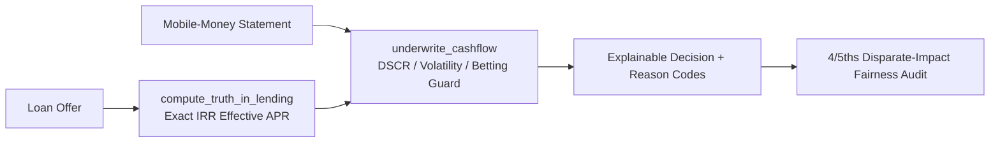

# cashflow-score

[](https://github.com/codesphere-u/cashflow-score/actions/workflows/ci.yml)
[](LICENSE)
[](pyproject.toml)
[](pyproject.toml)

**Explainable informal-SME & Mobile-Money cashflow underwriting engine: seasonality-adjusted DSCR, exact IRR effective-APR truth-in-lending disclosures, predatory-debt guards, and 4/5ths disparate-impact fairness auditor.**

- **Mission Domain:** Financial Inclusion & Responsible Micro-Credit
- **Stack:** Pure Python 3.11+ (zero runtime third-party dependencies, `mypy --strict`, `ruff`, `pytest`)
- **Maintainer:** Codesphere Innovations (U) Limited (`codesphere-u`)

---

## Problem Solved

Millions of East African micro-merchants are either excluded from formal credit or trapped by predatory black-box mobile loan apps charging >200% effective APR without transparent affordability or fairness audits.

## Key Features

- Exact bisection IRR effective-APR & truth-in-lending disclosure calculator (`compute_truth_in_lending`) flagging predatory credit offers.
- Transparent Mobile-Money / SME cashflow underwriter computing median & worst-month stress DSCR, revenue volatility CV, betting/gambling drain flags, and safe counter-offer principal caps.
- Demographic 4/5ths (80%) adverse-impact fairness auditor (`audit_disparate_impact`) preventing silent algorithmic bias across rural/urban or gender cohorts.

## Architecture Overview



See [docs/architecture.md](docs/architecture.md) for module-level design details.

## Installation

```bash
git clone https://github.com/codesphere-u/cashflow-score.git
cd cashflow-score
uv sync --extra dev
```

Or install in editable mode with standard `pip`:

```bash
pip install -e ".[dev]"
```

## Quick Start (CLI)

```bash
cashflow-score demo
```

## Quick Start (Python API)

```python
from cashflow_score import LoanOffer, compute_truth_in_lending

disc = compute_truth_in_lending(LoanOffer(1_000_000, 0.025, 20_000, 6))
assert disc.monthly_installment_minor > 0 and not disc.predatory_rate_warning
```

## Testing & Quality Gates

```bash
uv run ruff check src tests
uv run mypy src
uv run pytest -v
```

## Security, Contributing & Roadmap

- **Security:** See [SECURITY.md](SECURITY.md) for responsible disclosure procedures.
- **Contributing:** See [CONTRIBUTING.md](CONTRIBUTING.md) and [CODE_OF_CONDUCT.md](CODE_OF_CONDUCT.md).
- **Changelog & Roadmap:** See [CHANGELOG.md](CHANGELOG.md) and [ROADMAP.md](ROADMAP.md).

## License

MIT License — see [LICENSE](LICENSE).

## Support & Contact

Open an issue on [GitHub Issues](https://github.com/codesphere-u/cashflow-score/issues) or contact `codesphereinnovationz@gmail.com`.
